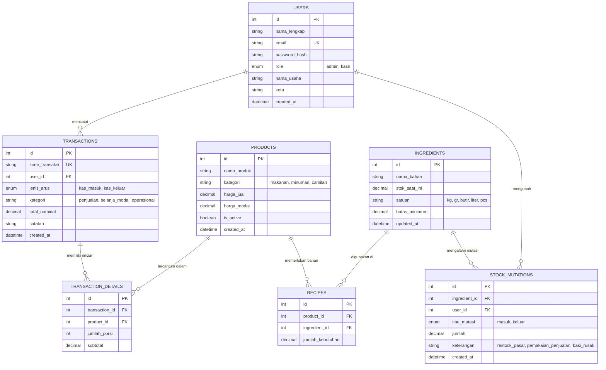

# Entity Relationship Diagram (ERD) — KawanUsaha Database

Dokumen ini menjelaskan struktur entitas data relasional untuk mengelola operasional kasir, stok bahan, dan keuangan warung kuliner.

---

## 1. Diagram Relasi Entitas (Mermaid Text Representation)



---

## 2. Definisi Skema SQL Langsung (`schema.sql`)

Dapat langsung disimpan ke dalam file `backend/database/schema.sql`:

```sql
-- Inisialisasi Database KawanUsaha
CREATE DATABASE IF NOT EXISTS kawanusaha_db CHARACTER SET utf8mb4 COLLATE utf8mb4_unicode_ci;
USE kawanusaha_db;

-- 1. Tabel Pengguna (Users)
CREATE TABLE IF NOT EXISTS users (
    id INT AUTO_INCREMENT PRIMARY KEY,
    nama_lengkap VARCHAR(100) NOT NULL,
    email VARCHAR(100) NOT NULL UNIQUE,
    password_hash VARCHAR(255) NOT NULL,
    role ENUM('admin', 'kasir') DEFAULT 'admin',
    nama_usaha VARCHAR(100) DEFAULT 'Warung Mitra',
    kota VARCHAR(50) DEFAULT 'Bekasi',
    created_at TIMESTAMP DEFAULT CURRENT_TIMESTAMP
);

-- 2. Tabel Produk Menu Makanan & Minuman (Products)
CREATE TABLE IF NOT EXISTS products (
    id INT AUTO_INCREMENT PRIMARY KEY,
    nama_produk VARCHAR(100) NOT NULL,
    kategori VARCHAR(50) NOT NULL,
    harga_jual DECIMAL(12, 2) NOT NULL,
    harga_modal DECIMAL(12, 2) NOT NULL DEFAULT 0.00,
    is_active BOOLEAN DEFAULT TRUE,
    created_at TIMESTAMP DEFAULT CURRENT_TIMESTAMP
);

-- 3. Tabel Bahan Mentah Inventaris Dapur (Ingredients)
CREATE TABLE IF NOT EXISTS ingredients (
    id INT AUTO_INCREMENT PRIMARY KEY,
    nama_bahan VARCHAR(100) NOT NULL,
    stok_saat_ini DECIMAL(10, 2) NOT NULL DEFAULT 0.00,
    satuan VARCHAR(20) NOT NULL,
    batas_minimum DECIMAL(10, 2) NOT NULL DEFAULT 1.00,
    updated_at TIMESTAMP DEFAULT CURRENT_TIMESTAMP ON UPDATE CURRENT_TIMESTAMP
);

-- 4. Tabel Relasi Komposisi Resep (Recipes)
CREATE TABLE IF NOT EXISTS recipes (
    id INT AUTO_INCREMENT PRIMARY KEY,
    product_id INT NOT NULL,
    ingredient_id INT NOT NULL,
    jumlah_kebutuhan DECIMAL(10, 2) NOT NULL,
    FOREIGN KEY (product_id) REFERENCES products(id) ON DELETE CASCADE,
    FOREIGN KEY (ingredient_id) REFERENCES ingredients(id) ON DELETE CASCADE
);

-- 5. Tabel Arus Kas & Transaksi Keuangan (Transactions)
CREATE TABLE IF NOT EXISTS transactions (
    id INT AUTO_INCREMENT PRIMARY KEY,
    kode_transaksi VARCHAR(50) NOT NULL UNIQUE,
    user_id INT NOT NULL,
    jenis_arus ENUM('kas_masuk', 'kas_keluar') NOT NULL,
    kategori VARCHAR(50) NOT NULL,
    total_nominal DECIMAL(12, 2) NOT NULL,
    catatan TEXT,
    created_at TIMESTAMP DEFAULT CURRENT_TIMESTAMP,
    FOREIGN KEY (user_id) REFERENCES users(id) ON DELETE RESTRICT
);

-- 6. Tabel Rincian Menu Penjualan (Transaction Details)
CREATE TABLE IF NOT EXISTS transaction_details (
    id INT AUTO_INCREMENT PRIMARY KEY,
    transaction_id INT NOT NULL,
    product_id INT NOT NULL,
    jumlah_porsi INT NOT NULL DEFAULT 1,
    subtotal DECIMAL(12, 2) NOT NULL,
    FOREIGN KEY (transaction_id) REFERENCES transactions(id) ON DELETE CASCADE,
    FOREIGN KEY (product_id) REFERENCES products(id) ON DELETE RESTRICT
);

-- 7. Tabel Mutasi Stok Bahan Dapur (Stock Mutations)
CREATE TABLE IF NOT EXISTS stock_mutations (
    id INT AUTO_INCREMENT PRIMARY KEY,
    ingredient_id INT NOT NULL,
    user_id INT NOT NULL,
    tipe_mutasi ENUM('masuk', 'keluar') NOT NULL,
    jumlah DECIMAL(10, 2) NOT NULL,
    keterangan VARCHAR(100) NOT NULL,
    created_at TIMESTAMP DEFAULT CURRENT_TIMESTAMP,
    FOREIGN KEY (ingredient_id) REFERENCES ingredients(id) ON DELETE CASCADE,
    FOREIGN KEY (user_id) REFERENCES users(id) ON DELETE RESTRICT
);
```